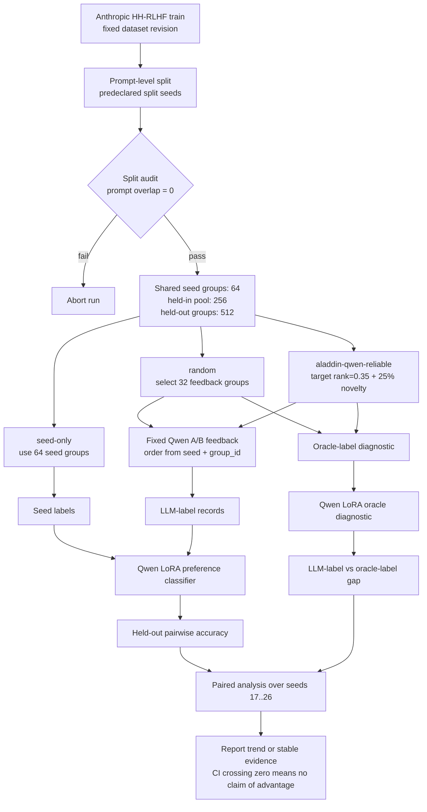

# HH-RLHF Qwen Protocol

This document is the canonical flow for the current Aladdin core-technology-one
experiment. The old `formal-hh-rlhf-qwen-v1` run is retained as a historical
baseline; the current main strategy is `aladdin-qwen-reliable` under
`custom-diagnostic-v1`.

## Frozen Controls

| Component | Formal setting |
|---|---|
| Strategies | `seed-only`, `random`, `aladdin-qwen-reliable` |
| Seeds | `17..26` per split |
| Split | `prompt`, predeclared split seed, abort on overlap |
| Feedback budget | 32 groups per feedback strategy |
| Training exposure | `equal-epochs`, 100 seed-only reference steps |
| Evaluation batch | 8 for split 17/23/29; 16 for split 37 |
| Feedback model | `Qwen/Qwen2.5-7B-Instruct`, pinned revision |
| Task model | Same Qwen snapshot with LoRA preference classifier |
| Selector | 75% target-centered uncertainty value + 25% prompt novelty; target rank `0.35` |
| Evaluation | 512 held-out groups, pairwise accuracy |
| Test set | Official test remains sealed |

## Split Schedule

The completed schedule contains prompt splits 17, 23, 29 and 37. Results are
reported within split using paired seeds; split-level averages are descriptive
and are not treated as a pooled test over independent observations.

Split 17 is exploratory because the reliable target was fixed after the earlier
diagnostic. Splits 23, 29 and 37 are confirmation runs under the frozen rule.
The split-37 Oracle-label result is lower than random and is retained as
heterogeneity evidence; it is not omitted in favor of the LLM-label result.

## Interpretation Boundary

This is a single-round historical replay. Qwen supplies simulated feedback from
existing HH-RLHF pairs. The run does not create new answers, collect new human
labels, or update the selector from downstream training gain. It tests whether
the selection rule improves this downstream preference-classification task. It
does not demonstrate the complete recursive RSI loop, technical two, technical
three, SFT, DPO, or official HH-RLHF test performance.
